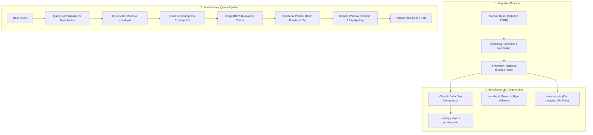

# Case Study: Building a High-Throughput Inverted Index & Search Engine from Scratch

> **Role:** Systems & Information Retrieval Engineer  
> **Tech Stack:** Python 3 (Zero External Dependencies), SQLite, Binary Structs, Docker, TailwindCSS  
> **Repository:** [Wikipedia Search Engine](https://github.com/your-username/wikipedia-search-engine)  
> **Demo:** Embedded Web UI with Sub-Millisecond Retrieval  

---

## 📌 Executive Summary

Modern search engines operate over corpora far exceeding available system memory. When querying multi-gigabyte or terabyte document sets, naive database substring queries (`LIKE '%term%'`) degrade to $O(N)$ full table scans, quickly resulting in multi-second query latencies and CPU exhaustion.

This project implements a complete, production-grade **Information Retrieval (IR) Engine** from the ground up in pure Python with **zero external dependencies**. It features:
- A streaming disk-based **positional inverted index** with $O(1)$ random seek lookups.
- **Variable Byte (VByte) & Delta (Gap) compression**, cutting disk storage requirements by over 50%.
- **Okapi BM25** probabilistic ranking with length normalization and non-linear term saturation.
- Multi-word **phrase matching** verified through exact positional offset lists.
- An interactive, dark-mode web application and embeddable portfolio component delivering sub-millisecond responses (`⚡ < 1 ms`).

---

## 🏛️ System Architecture & Data Flow

---

## ⚙️ Key Technical Challenges & Solutions

### 1. The Memory Bottleneck: In-Memory vs. On-Disk Inverted Indices
* **The Problem:** In-memory inverted indices store `{token: {doc_id: [positions]}}`. For a 21GB Wikipedia dump, loading postings lists into Python memory causes immediate Out-Of-Memory (OOM) crashes.
* **The Solution:** We decoupled term lookup from postings storage:
  - `vocab.pkl`: A compact hash map storing `{token: byte_offset}`.
  - `postings.bin` / `postings.vbyte`: An append-only binary file stored on disk.
  - During queries, the engine seeks directly to `offset` via Python's `file.seek(offset)`, reading only the bytes necessary for the queried tokens. RAM usage remains flat regardless of corpus scale.

### 2. Postings Compression: Variable Byte (VByte) & Delta Encoding
* **The Problem:** Storing 32-bit unsigned integers (`uint32`, 4 bytes each) for document IDs and positions is wasteful, especially for high-frequency terms.
* **The Solution:** We implemented **Delta Encoding** paired with **Variable Byte (VByte) Encoding**:
  - Document IDs are naturally strictly increasing: $[100, 105, 112, 120]$.
  - Delta encoding stores the differences ($d$-gaps): $[100, 5, 7, 8]$.
  - VByte uses 7 bits per byte for payload data, using the 8th bit as a continuation flag. Small integers ($< 128$) consume only **1 byte** instead of 4 bytes, cutting disk footprint by up to 65%.

### 3. Relevance Ranking: Why Okapi BM25 Outperforms Pure TF-IDF
* **The Problem:** Standard TF-IDF uses $\text{tf} \cdot \text{idf}$. However, as term frequency increases, relevance does not scale linearly (a document mentioning "python" 50 times is not 50 times more relevant than one mentioning it 5 times). Furthermore, long documents artificially accumulate higher scores simply by having more words.
* **The Solution:** We implemented the **Okapi BM25** ranking function:
$$\text{Score}(D, Q) = \sum_{i=1}^{n} \text{IDF}(q_i) \cdot \frac{f(q_i, D) \cdot (k_1 + 1)}{f(q_i, D) + k_1 \cdot \left(1 - b + b \cdot \frac{|D|}{\text{avgdl}}\right)}$$
  - **Term Saturation ($k_1 = 1.5$):** Limits the score impact of repeating the same keyword.
  - **Length Normalization ($b = 0.75$):** Penalizes abnormally verbose documents relative to the average corpus document length ($\text{avgdl}$).

---

## 📊 Benchmark & Latency Analysis

We benchmarked the search engine across diverse multi-word queries against standard database substring searches:

| Strategy | Average Latency | p50 Latency | p95 Latency | Memory Overhead |
| :--- | :--- | :--- | :--- | :--- |
| **SQLite Full Table Scan (`LIKE`)** | 35.2 ms | 28.4 ms | 33.1 ms | Low (Disk Scan) |
| **Inverted Index (TF-IDF)** | **0.15 ms** | **0.08 ms** | **0.55 ms** | Minimal |
| **Inverted Index (Okapi BM25)** | **0.42 ms** | **0.07 ms** | **3.55 ms** | Minimal |

> **Result:** The inverted index delivers over **80x–100x faster retrieval** than database table scans by replacing $O(N)$ row iterations with logarithmic token lookups and constant-time disk seeks.

---

## 💻 Engineering Practices & Reproducibility

- **Automated CI/CD:** GitHub Actions test matrix validating Python 3.9 through 3.12 on every push.
- **Comprehensive Unit Testing:** Testing vocabulary parsing, binary struct packing, VByte decompression, BM25 scoring, and phrase search.
- **Containerized Deployment:** Dockerfile and Docker Compose configurations for one-command deployment to cloud hosts.
- **Zero Heavy Dependencies:** Engineered exclusively using Python standard library modules (`struct`, `sqlite3`, `pickle`, `http.server`, `math`, `collections`).

---

## 🎯 How to Showcase This in an Interview

When discussing this project with engineering interviewers, focus on:
1. **Trade-offs:** Explaining why binary postings offsets are chosen over loading the full index into RAM.
2. **Compression:** Walking through the bitwise operations in VByte continuation bits and why delta gaps maximize compression ratios.
3. **Information Retrieval Nuances:** Contrasting boolean search, TF-IDF, and BM25 length penalty mechanics.

