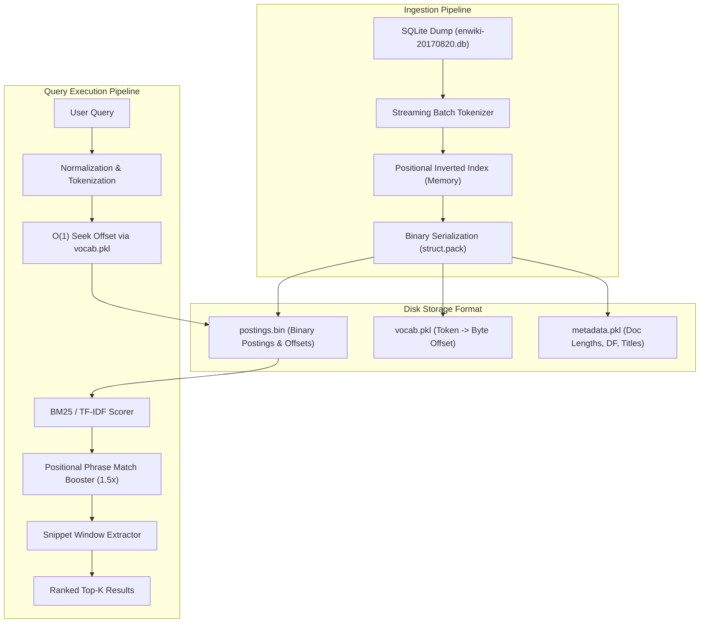

# ⚡ Wikipedia Information Retrieval Engine

[](https://www.python.org/)
[](LICENSE)
[]()
[]()

A high-performance, disk-based information retrieval (IR) engine built from scratch in Python with **zero external dependencies**. Implements positional inverted indexing, binary disk serialization, and **Okapi BM25** probabilistic ranking with phrase-match boosting and sub-millisecond retrieval latency.

---

## 📸 Interactive Web Demo

The project includes an interactive web dashboard and REST API powered entirely by Python's built-in `http.server`:

- **Instant search** with real-time response time tracking (`⚡ < 1 ms`)
- **Interactive algorithm toggle**: compare **Okapi BM25**, **TF-IDF**, and **Simple Frequency** side-by-side
- **Contextual snippet extraction** with dynamic query term highlighting
- **Architecture visualizer** detailing binary postings layout and query pipelines

```bash
# Start the web interface
python3 app.py
# Open http://localhost:8080 in your browser
```

---

## 🏛️ System Architecture



---

## 📦 Binary Inverted Index Specification

To handle large dumps (up to 21GB+) without RAM exhaustion, postings lists are packed into a single binary file (`postings.bin`) and indexed by byte offset in `vocab.pkl`:

```
postings.bin Structure:
┌────────────────────────────────────────────────────────┐
│ number_of_docs (uint32, 4 bytes)                       │
├────────────────────────────────────────────────────────┤
│  For each document:                                    │
│    ├── doc_id (uint32, 4 bytes)                        │
│    ├── term_frequency (uint32, 4 bytes)                │
│    ├── positions_count (uint32, 4 bytes)               │
│    └── positions (list of uint32, tf * 4 bytes)        │
└────────────────────────────────────────────────────────┘

vocab.pkl:
  {"machine": 0x0000, "learning": 0x0184, "quantum": 0x0320, ...}
```

**Why this matters:**
- **Zero in-memory postings footprint**: RAM only stores term offsets (`vocab.pkl`) and document lengths.
- **O(1) disk lookup**: Given a search term, the engine seeks directly to its byte offset in `postings.bin` and reads only the relevant document postings.

---

## 🚀 Quickstart (30 Seconds)

### 1. Seed Sample Articles
No need to download a 21GB dump for testing! Seed sample articles into SQLite:
```bash
python3 seed_data.py --offline
```
*(Optionally fetch live Wikipedia articles online using `python3 seed_data.py --count 50`)*

### 2. Search via CLI
```bash
python3 search_engine.py --query "machine learning" --algo bm25
```

**Example CLI Output:**
```text
🔍 Query: 'machine learning' | Algorithm: BM25

⚡ Found 1 result(s) in 0.03 ms:
────────────────────────────────────────────────────────────
[1] Machine learning (ID: 1) ─ Score: 9.9363
    Machine learning is a field of inquiry devoted to understanding and building methods that learn from data. Machine learning algorithms build a model based on sample data, known as training ...
────────────────────────────────────────────────────────────
```

### 3. Launch Web UI
```bash
python3 app.py
```
Open **[http://localhost:8080](http://localhost:8080)**.

### 4. Run Test Suite
```bash
python3 test_search_engine.py
```

---

## 🌐 Embed in Your Portfolio Website

You can embed this search engine demo directly into your personal portfolio or case study page using an iframe:

```html
<iframe 
  src="http://localhost:8080" 
  width="100%" 
  height="700" 
  style="border: none; border-radius: 16px; box-shadow: 0 10px 30px rgba(0,0,0,0.1);"
  title="Wikipedia IR Engine Demo">
</iframe>
```

---

## 📊 Supported Ranking Algorithms

| Algorithm | Method | Characteristics |
| :--- | :--- | :--- |
| **Okapi BM25** | `engine.search_bm25(query)` | Industry standard probabilistic model. Features document length normalization ($b=0.75$) and sub-linear term frequency saturation ($k_1=1.5$). |
| **TF-IDF** | `engine.search_tfidf(query)` | Classical log-normalized term frequency weighted by smoothed inverse document frequency. |
| **Simple Count** | `engine.search_simple(query)` | Unweighted term frequency count baseline. |
| **Phrase Matching** | `engine.phrase_search(query)` | Positional verification for exact multi-word phrase matching with 1.5x score boost. |

---

## 🗃️ Dataset

- SQLite Wikipedia dump: `enwiki-20170820.db`
- [Kaggle Dataset Source](https://www.kaggle.com/datasets/jkkphys/english-wikipedia-articles-20170820-sqlite/)
- Schema:
  ```sql
  CREATE TABLE ARTICLES (
    ARTICLE_ID INTEGER PRIMARY KEY,
    TITLE TEXT,
    SECTION_TITLE TEXT,
    SECTION_TEXT TEXT
  );
  ```

---

## 📄 License
MIT License. Created as an educational systems and information retrieval project.
